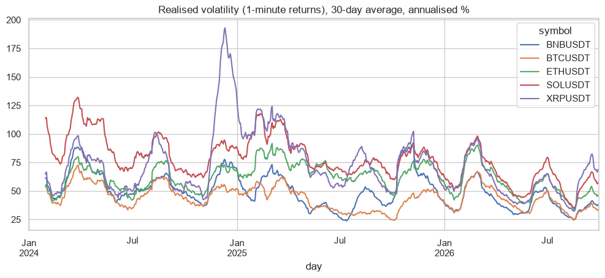
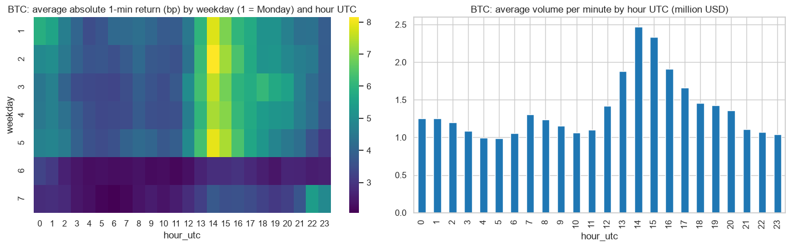

# Crypto data lakehouse with Polars and DuckDB

7.2 million 1-minute candles of BTC, ETH, SOL, BNB and XRP (January 2024 to September 2026) from the official Binance public data, stored as parquet partitioned by symbol, year and month, and queried directly on the files with Polars (lazy) and DuckDB (SQL).

## Pipeline

```
data.binance.vision (monthly zip files)
   -> raw/     zip files as they come                            (bronze)
   -> lake/    parquet, typed, deduplicated, symbol/year/month    (silver)
   -> lakehouse_analysis.ipynb   quality checks, benchmark, analysis
```

`ingest.py` only downloads the months that are missing, and it handles a change of format of the source: in January 2025 Binance moved the timestamps of spot data from milliseconds to microseconds.

## Results
- **Quality:** no missing minutes, no duplicates and no impossible prices (high below open or close) in the 7.2 million rows.
- **Benchmark** (daily realised volatility of every symbol, window function + group by on all the rows):

| Engine | Seconds |
|---|---|
| pandas | 7.1 |
| Polars (lazy) | 2.3 |
| DuckDB (SQL on parquet) | 2.6 |

- **Realised volatility** (median, annualised): BTC 41%, BNB 44%, ETH 56%, XRP 61%, SOL 72%.
- **When Bitcoin moves:** the most at 14:00 UTC (US open and macro data), the least at 05:00 UTC; on weekends the average absolute return is 41% lower.
- **Implied vs realised:** the 30-day implied volatility of Deribit (DVOL) was above the realised volatility of the next 30 days in 66% of the days, by 2.7 points on average.




## How to run

```
pip install -r requirements.txt
python ingest.py          # around 300 MB of zip files
jupyter notebook lakehouse_analysis.ipynb
```

---
Alejandro Lezcano Osorio | Rennes School of Business (MSc in Financial Data Intelligence) and Universidad EIA
